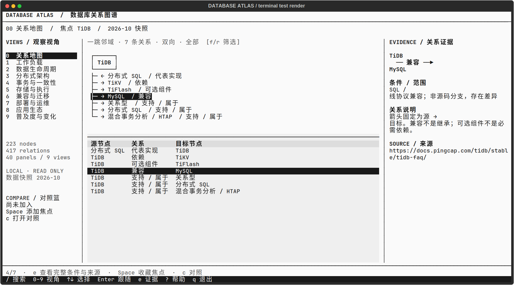

# Database Atlas TUI

真正运行在终端中的只读数据库知识图谱浏览器。Python + Textual；不是网页包装，也不连接任何生产数据库。



223 个节点 · 417 条关系 · 九种观察视角 · 本地数据快照 · 中文友好

## 启动

```bash
git clone https://github.com/jupiternaut/database-atlas-tui.git
cd database-atlas-tui
uv venv --python 3.12 .venv
uv pip install --python .venv/bin/python -r requirements.txt
./run.sh
```

需要 Python 3.12+ 与支持 Unicode 的终端。默认焦点 TiDB。可使用 `./run.sh --start postgresql` 或 `--data-root /path/to/snapshots`。没有 `uv` 时也可使用 `python3 -m venv .venv`，再运行 `.venv/bin/python -m pip install -r requirements.txt`。
建议 150×40 字符；80×24 自动收起导航和右侧证据，使用数字键切视角、`e` 查看全文。
字体由终端控制，程序不修改终端配置。可在终端中选 JetBrains Mono，中文由已安装的 CJK 字体回退。

## 操作

| 键 | 功能 |
| --- | --- |
| `/` | 搜索原图节点和九视角面板；支持 Pinot 等仅存在于新版面板的产品 |
| `0` | 原关系图的一跳邻域 |
| `1`–`9` | 工作负载、数据生命周期、分布式架构、事务一致性、存储执行、兼容迁移、部署运维、应用生态、普及度 |
| `[` / `]` | 上一个 / 下一个面板；也可点击顶部下拉框 |
| `↑` / `↓` | 选择关系 / 表格行 |
| `Enter` | 沿邻接关系跳转；面板中打开可识别产品或证据 |
| `Backspace` | 返回并恢复上次选中行 |
| `f` / `r` | 原图中按方向 / 关系类型循环筛选 |
| `e` | 查看完整字段、适用条件与来源；点击“打开来源”才访问外部网站 |
| `Space` | 当前焦点加入或移出对照篮，最多三项 |
| `c` | 描述性对照：类型、模型、热度及图谱覆盖情况，不是性能评测 |
| `Tab` | 控件间切换；宽表内 `←` / `→` 横向滚动 |
| `?` | 帮助 |
| `Esc` / `q` | 关闭弹窗 / 退出程序 |

鼠标支持视角导航、面板选择、表格行选择和滚动。弹窗内不会执行主页面的视角快捷键。

## 数据与设计

仓库内置下列数据快照，仅读取、不改写：

- `data/database-graphs-v2/graph.json`：223 节点、417 条关系。
- `data/database-perspectives-v3/knowledge.json`：九视角、40 个面板；保留 graph、matrix、bars、deltas 的不同表达。
- `data/database-perspectives-v3/popularity-observations.json`：440 条排名历史记录；第九视角另提供完整榜单面板。

本地数据快照为 2026-10；应用不会自动更新这些事实，也未在本轮重新抓取或重新审核全部来源。

关系地图只展开焦点的一跳邻域，避免全图连线堆叠。中心字符图与下方完整关系表联动；在面板视角中展示选中关系的方向路径。矩阵保留原始各列，较长内容可用 `e` 查看。热度采用线性字符条与数字，而不是在等宽终端里伪造不同字号。

同一实体可以属于多个视角；分类不是排他的树。箭头始终保留原数据的源 → 目标。兼容、继承、依赖、可选组件分别表达，不混为一种关系。面板中的“SQL 客户端”等是局部角色，不能冒充全局产品节点。

切视角时保留焦点，优先跳到包含该实体的面板；未收录时明确显示“焦点未收录；浏览全体”，不推导为不支持。不存在的热度不补 0。架构图来自资料，不代表用户机器的实际部署。

## 独立安装与测试

运行时依赖只装在当前项目 `.venv`，没有修改系统 Python：

```bash
uv venv .venv
uv pip install --python .venv/bin/python -r requirements.txt
```

克隆即可取得运行数据，不依赖原作者的工作区或私人服务。`--data-root` 仍支持原 `outputs` 布局，且显式指定的路径缺失时会报错，不静默改用其他数据。

```bash
uv pip install --python .venv/bin/python -r requirements-dev.txt
env -u PYTHONPATH PYTEST_DISABLE_PLUGIN_AUTOLOAD=1 .venv/bin/python -m pytest -p pytest_asyncio.plugin tests -q
.venv/bin/python preview.py
```

隔离 pytest 自动加载，避免本机 ROS 的全局插件影响测试。测试覆盖源数据只读、别名边界、关系方向、面板覆盖、搜索、键盘和鼠标交互、窗口动态缩放、证据、返回历史与对照。

`previews/` 为应用通过 Textual 测试渲染器输出的终端预览，不是原生桌面窗口截图。预览工具使用系统已有的 JetBrains Mono / Noto Sans Mono CJK SC，并修正 SVG 导出的字符格定位；它不修改实际终端字体。预览依赖 CairoSVG，运行应用本身不需要。

## 来源与发布范围

见 [PUBLICATION.md](PUBLICATION.md)。技术说明、来源 URL 和适用条件保留在 JSON 及界面的证据窗口中。第三方数据库文档、排名来源、字体及依赖的权利归各自权利人；本次发布未替作者选择新的开源许可证。
